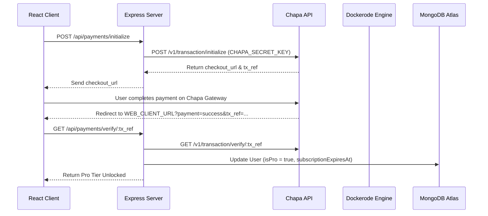

# Architecture SOP - SynapseCode System Blueprint

## 1. Overview & System Purpose
SynapseCode is a real-time collaborative coding workspace with containerized Docker sandboxing and SaaS tiering powered by the Chapa Payment Gateway.

---

## 2. A.N.T. 3-Layer Architecture Mapping

### Layer 1: Architecture (Documentation & SOPs)
- Technical blueprints, data contracts, and protocol invariants stored under `/architecture/`.
- [gemini.md](file:///d:/Project/best%20project/synapse-code/synapse-code/gemini.md) defines database schemas and security policies.

### Layer 2: Navigation & Orchestration
- Express REST controllers:
  - `server/controllers/authController.js`: Registration, Login, Profile retrieval.
  - `server/controllers/roomController.js`: Room creation, joining, listing, saving.
  - `server/controllers/paymentController.js`: Chapa initialization, verification, webhook parsing.
- Real-Time Sockets & Signaling:
  - `server/index.js`: Socket.io events (`join-room`, `send-message`, `run-code`, `cursor-update`).
  - Yjs WebSocket server (`/yjs`) for CRDT document binding.

### Layer 3: Deterministic Tools & Sandbox Execution
- Ephemeral Execution Engine: `server/execute.js` (Dockerode API wrapper).
- Diagnostic Tools: `/tools/health_check.js` for connectivity verification.
- Frontend Workspace: Monaco Editor, Yjs bindings, Pricing Modal, Output Console.

---

## 3. Data Flow Contract

